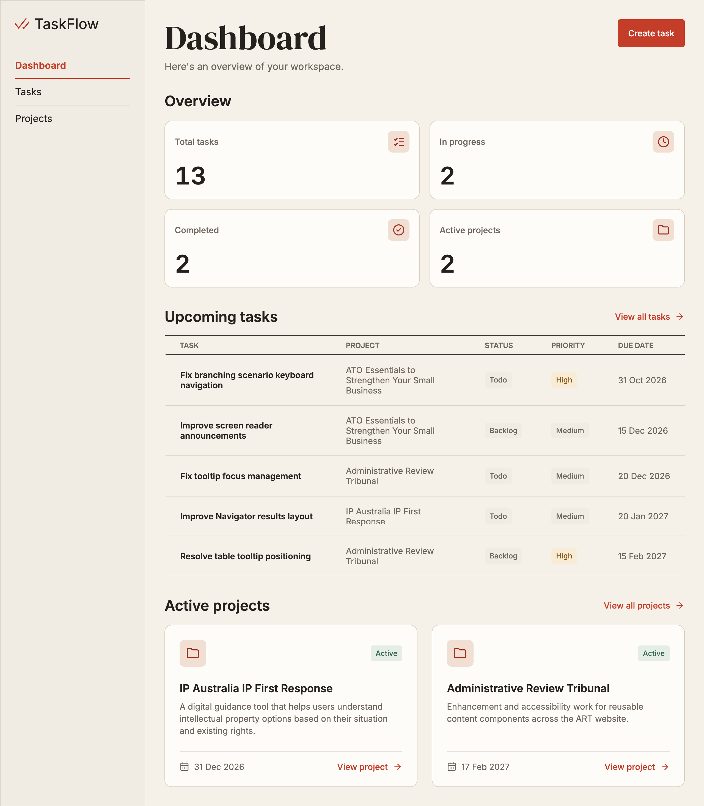
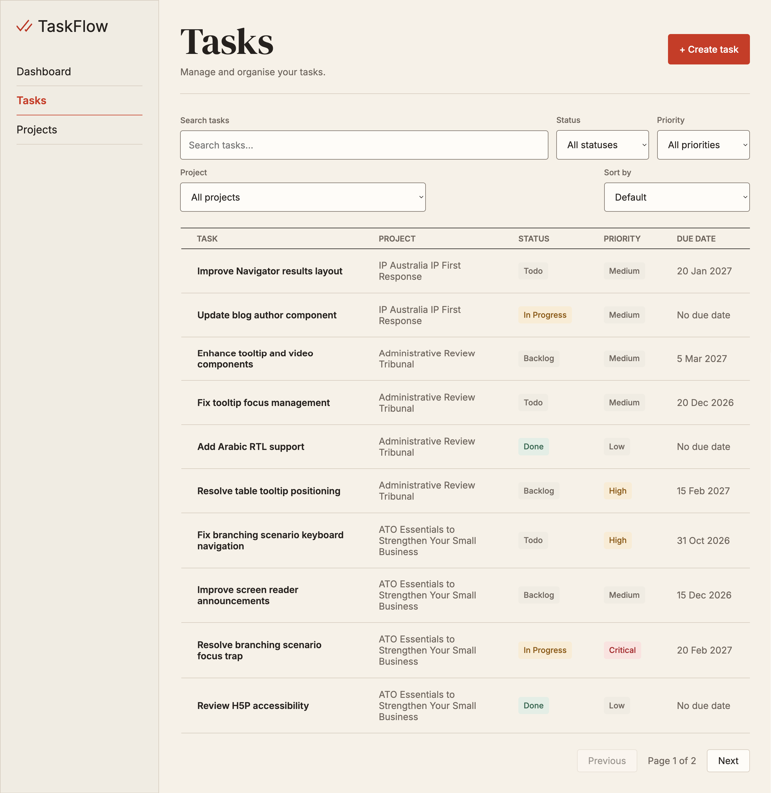

# TaskFlow

**An accessible task and project management dashboard built with React and TypeScript.**

TaskFlow is a frontend portfolio project focused on building maintainable, accessible, and user-friendly web applications using modern React development practices.

The application allows users to manage tasks across multiple projects, track progress, and organise work through a responsive dashboard.



## Features

### Dashboard

- View task statistics, including total, in-progress, and completed tasks
- Track the number of active projects
- View upcoming tasks sorted by due date
- Quickly navigate to tasks and projects

### Task Management

- Create, view, edit, and delete tasks
- Assign tasks to projects
- Manage task status, priority, and due dates
- Search, filter, sort, and paginate tasks
- View individual task details
- Handle loading, error, and empty states



### Project Management

- Browse projects and view project details
- Track project status and due dates
- View tasks associated with each project
- Navigate between projects and their tasks

### Accessibility

Accessibility is a core consideration throughout the application.

Implemented features include:

- Semantic HTML and accessible form controls
- Keyboard navigation and visible focus indicators
- Accessible form validation and error messages
- Focus management for form errors and confirmation dialogs
- Accessible loading, error, and empty states
- Reduced-motion support
- Responsive navigation and layouts

The application follows WCAG accessibility principles, with further manual accessibility testing planned.

## Tech Stack

| Category      | Technologies                              |
| ------------- | ----------------------------------------- |
| Frontend      | React 19, TypeScript 6, Vite 8            |
| Routing       | React Router 7                            |
| Styling       | SCSS, CSS Custom Properties               |
| UI Components | Reusable React components, Lucide React   |
| API           | REST API, JSON Server                     |
| Testing       | Vitest, React Testing Library, User Event |
| Code Quality  | ESLint                                    |
| CI            | GitHub Actions                            |

## Architecture & Technical Decisions

The application uses a component-based architecture with separation between UI components, pages, custom hooks, and utility functions.

### Reusable Components

Shared components such as buttons, form controls, badges, confirmation dialogs, task lists, and project cards promote consistency and maintainability.

### Custom Hooks

Custom hooks encapsulate data-fetching logic and related loading and error states, keeping page components focused on presentation and user interactions.

### State Management

React hooks manage local application state, while derived values are used for task filtering, sorting, and dashboard statistics.

This reduces unnecessary state duplication and keeps the application logic easier to maintain.

### Client-Side Routing

React Router provides navigation between the dashboard, task lists, task details, task forms, and project pages.

### Design System

The UI uses SCSS and CSS custom properties to define reusable design tokens for colours, typography, spacing, borders, and focus styles.

This provides a consistent visual language across the application.

## Testing

TaskFlow uses **Vitest** and **React Testing Library** to test component behaviour and user interactions.

Tests cover areas such as:

- Task form validation
- Task item rendering
- Confirmation dialog interactions
- Task detail page behaviour

Run tests in watch mode:

```bash
npm test
```

Run all tests once:

```bash
npm run test:run
```

## Continuous Integration

A GitHub Actions CI workflow runs automated quality checks on pushes and pull requests.

The workflow includes:

1. Install dependencies with `npm ci`
2. Run ESLint
3. Execute automated tests
4. Run the TypeScript checks and production build

These checks help identify issues before changes are merged into the main branch.

## Getting Started

### Prerequisites

- Node.js 22.12+ or a compatible newer version
- npm

### Installation

Clone the repository:

```bash
git clone https://github.com/ninalix/task-flow.git
cd task-flow
```

Install dependencies:

```bash
npm ci
```

### Start the Mock API

TaskFlow uses JSON Server to simulate a REST API with data stored in `db.json`.

Open a terminal and run:

```bash
npm run server
```

By default, the API is available at:

`http://localhost:3000`

### Start the Frontend

Open a second terminal and run:

```bash
npm run dev
```

Vite will display the local development URL, typically:

`http://localhost:5173`

Open the URL in your browser to use TaskFlow.

**Note:** Both the frontend development server and JSON Server must be running for data-dependent features to work.

## Available Scripts

| Command            | Description                                         |
| ------------------ | --------------------------------------------------- |
| `npm run dev`      | Start the Vite development server                   |
| `npm run server`   | Start JSON Server using `db.json`                   |
| `npm test`         | Run Vitest in watch mode                            |
| `npm run test:run` | Run tests once                                      |
| `npm run lint`     | Run ESLint                                          |
| `npm run build`    | Run TypeScript checks and create a production build |
| `npm run preview`  | Preview the production build locally                |

## Future Improvements

- Add Playwright end-to-end tests
- Complete responsive and cross-browser accessibility testing
- Deploy a live demo with a hosted API
- Expand automated test coverage

## Author

**Xiaoyu Li**

Frontend Developer focused on accessible, user-centred web applications.

[GitHub](https://github.com/ninalix)
